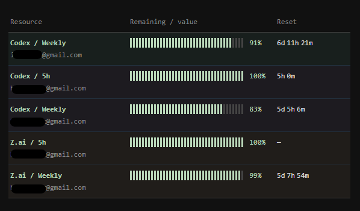

# Resource monitor

Local monitor screen and polling loop. Demo amounts are fictitious. Codex ChatGPT subscription-limit and GLM Coding Plan quota adapters are available; real accounts need authorization and live verification. OpenAI API, Claude, and Z.ai Standard API credits are not connected.



## Docker Compose

Docker Compose 2.24+ is the only runtime requirement on the host; Node 24 and Codex CLI 0.167.0 are in the image. Keep this checkout on a Linux filesystem (including WSL), so private Codex profile ownership and modes work. For a demo, run:

```sh
cp -n config.example.json config.json
umask 077; mkdir -p .monitor-codex
docker compose up -d --build
```

Open `http://127.0.0.1:8765`. Use `docker compose ps` and `docker compose logs -f monitor` to inspect it, and `docker compose down` to stop it. The published port is bound to host loopback. `config.json` is mounted read-only; `.monitor-codex` persists on the host. Compose requires both paths to exist and will not create them as root. Keep `config.json` as a file, and `.monitor-codex` and each profile directory owned by the container UID with mode 0700. Codex `auth.json` must have the same owner and private mode (0600 is suitable). The default UID/GID is 1000:1000; on another Linux UID/GID, set `MONITOR_UID` and `MONITOR_GID` in `.env` to your `id -u` and `id -g` before starting, and keep those values for every Compose command. Existing profiles must have matching ownership; do not copy or share credentials. The image contains no config, tokens, or profiles.

For GLM Coding Plan, copy `config.glm.example.json` instead of the demo example, then create an owner-only `.env` containing each `ZAI_PLAN_*_TOKEN` named by the config. For Codex-only or demo, `.env` is optional. Start with the same `docker compose up -d --build` command. For an empty screen, use a `config.json` containing `{"accounts":[]}`. Edit `locale` (`en` or `ru`) and account/source IDs and labels in `config.json`. After changing config or `.env`, run `docker compose up -d --force-recreate monitor` and refresh the browser; the in-memory cache resets. Rebuild after changing application code or the Dockerfile.

After the initial build and setup above, stop the monitor for each new Codex profile and run the login helper in the image:

```sh
docker compose stop monitor
docker compose run --rm -it --no-deps monitor node codex-login.mjs personal
docker compose start monitor
```

Replace `personal` with each distinct alias (`work`, etc.). The helper uses Codex device authorization: open the URL printed in the terminal on your own browser and enter its one-time code. The browser does not need to reach a callback inside the container. If a managed workspace blocks this flow, its owner must enable [device code authentication for Codex CLI](https://developers.openai.com/zh-Hans/docs/enterprise/access-tokens); never share the code. Run the login command again for another alias; the existing `.monitor-codex/<alias>` profile stays in place. If the screen says “Authorization needed”, complete that profile's login and use Refresh. After an abrupt shutdown, verify no monitor or login process owns a profile before removing a stale `.monitor-lock`; restart does not remove locks automatically.

Each account and source needs a unique ID within its parent. Codex shows the authenticated account email when available, falling back to its configured `label`. For other accounts, set `label` to the email you want displayed. An optional account `color` (for example `"color": "#a990cb"`) sets a subtle row tint; otherwise each account gets a subtle color from a repeating eight-color palette, in config order. `demo` supplies fictitious data for either `subscription` or `api`. `zai` reads GLM Coding Plan subscription quotas only. Add more accounts in config with distinct IDs and env names. Never put token values in config, URLs, command arguments, logs, or the browser. The Z.ai adapter does not use working login sessions or support `local:` references.

For two Codex accounts plus one GLM account, use the combined example (keep an existing `config.json` and merge its entries instead):

```sh
cp -n config.codex.example.json config.json
umask 077; mkdir -p .monitor-codex
# Put ZAI_MONITOR_TOKEN=<your token> in the owner-only .env file.
docker compose up -d --build
docker compose stop monitor
docker compose run --rm -it --no-deps monitor node codex-login.mjs personal
docker compose run --rm -it --no-deps monitor node codex-login.mjs work
docker compose start monitor
```

Each alias uses its own private `.monitor-codex/<alias>` directory and may appear only once in the config. The monitor stays stopped while a profile is being authorized, so its profile lock cannot conflict with login.

Z.ai displays remaining GLM Coding Plan quota, not Standard API credits or a billing balance. It uses an undocumented quota interface that may change. Missing values appear as unknown; previously known values remain visible as stale until updated.

Missing tokens and authorization errors pause the affected source until manual Refresh. Other accounts continue independently. The current credit schema and token eligibility have been checked with one live Z.ai account; comparison with the provider UI and isolation of two live accounts remain unverified.

Optional server environment variables: `MONITOR_CONFIG` points to a config JSON file; `MONITOR_PORT` sets the port (default 8765); `MONITOR_HOST` is `127.0.0.1` by default or `0.0.0.0` for the container. No URL or command-line argument accepts secrets.


## Windows widget

On Windows 10 x64, use a Windows-local copy of this checkout (for example `C:\src\resource-monitor`), then run `npm ci --ignore-scripts`, `npm run desktop:setup`, and `npm run desktop` there in a Windows terminal for development. `npm` through a WSL UNC working directory is unreliable. Electron 45.3.1 is pinned in the lockfile; its binary is installed by the explicit setup command. The window initially opens at 600×420 DIP in the primary display's upper-right work area, shrinking to fit a smaller work area. Use the tray's Display and Corner menus to choose a screen and one of its four corners; the choice and Always on top setting survive restart in the Electron user profile's `widget.json`. If the chosen screen disconnects, the window moves to the primary screen and returns to the saved screen and corner when it reconnects. Display IDs identify saved screens; menu numbers only help find a screen in the current list. Drag the narrow strip above the table. The tray menu also shows, hides, refreshes, toggles always-on-top, and exits the widget; closing the window hides it. A second launch restores the existing window. The tray language follows the server's `locale` on a successful page load.

For a portable build, run `npm run desktop:package:win` after the Windows setup above. It writes `dist/resource-monitor-win32-x64/Resource Monitor.exe` with its own Electron runtime. The build copies only `desktop/main.cjs`, `position.cjs`, `offline.html`, `icon.png`, and a minimal app manifest; `dist/.../artifact.json` records source SHA-256 hashes. The builder needs Node, but the user launching the built exe does not. Keep the entire output folder together. Install it in a permanent user folder with spaces, for example:

```powershell
$install = Join-Path $env:LOCALAPPDATA 'Resource Monitor\Portable'
if (Test-Path -LiteralPath $install) { throw "Install folder already exists: $install" }
New-Item -ItemType Directory -Force -Path (Split-Path $install) | Out-Null
Copy-Item -LiteralPath '.\dist\resource-monitor-win32-x64' -Destination $install -Recurse
Start-Process -FilePath (Join-Path $install 'Resource Monitor.exe')
```

The portable tray's **Open at login** option is off by default. Check it to register only this app for the current Windows user; uncheck it to remove that registration. A second launch restores the existing window. Settings live outside the portable folder in Electron's user data directory (`%APPDATA%\Resource Monitor\widget.json` by default), and survive replacement of the portable folder. Before moving or replacing an installed folder, uncheck **Open at login**, choose **Exit**, replace the folder, launch from the new path, then check **Open at login** again. To uninstall, uncheck **Open at login**, choose **Exit**, and delete the portable folder; delete `%APPDATA%\Resource Monitor` only if you also want to discard this widget's saved settings. If Windows has disabled the entry in Startup Apps, re-enable it there or toggle the tray option off and on. The exe depends on the existing local server at `http://127.0.0.1:8765/`; it displays a waiting page until that server is available. The first failed check can start installed Docker Desktop, but it does not create or restart a stopped container.

If the local server is unavailable, the widget shows a waiting page and retries automatically. On the default port, it can start an installed Docker Desktop once; it cannot create or restart a stopped container. After a connection loss, the widget marks retained values stale until the server responds again.


Development history and plans are in [docs/PLAN.md](docs/PLAN.md); development checks are in [docs/DEVELOPMENT.md](docs/DEVELOPMENT.md).
